# gipfel

**Your GitHub contribution year as an animated mountain panorama.**
One contribution = one metre of elevation. Your busiest week becomes the summit.

<picture>
  <source media="(prefers-color-scheme: dark)" srcset="examples/gipfel-night.svg">
  
</picture>

- **Pure SVG** – no server, no external requests, renders directly on GitHub
- **Day & night** – light theme for light mode, starry night for dark mode
- **Animated** – a hiker walks your ridge, clouds drift, stars twinkle (respects `prefers-reduced-motion`)
- **Zero dependencies** – Python standard library only
- **Themeable** – a theme is one small JSON file ([add yours](CONTRIBUTING.md))

## Quick start

1. In your profile repository (`<your-name>/<your-name>`) create `.github/workflows/gipfel.yml`:

```yaml
name: gipfel
on:
  schedule:
    - cron: "0 3 * * *"   # daily
  workflow_dispatch:
permissions:
  contents: write
jobs:
  render:
    runs-on: ubuntu-latest
    steps:
      - uses: RexJonas333/gipfel@v1
        with:
          github_user_name: ${{ github.repository_owner }}
          outputs: dist
      - uses: crazy-max/ghaction-github-pages@v4
        with:
          target_branch: output
          build_dir: dist
        env:
          GITHUB_TOKEN: ${{ secrets.GITHUB_TOKEN }}
```

2. Run the workflow once (Actions → gipfel → Run workflow).

3. Add this to your `README.md` (replace `<your-name>`):

```html
<picture>
  <source media="(prefers-color-scheme: dark)" srcset="https://raw.githubusercontent.com/<your-name>/<your-name>/output/gipfel-night.svg">
  /<your-name>/output/gipfel-day.svg">
</picture>
```

## Options

| Input | Default | Description |
|---|---|---|
| `github_user_name` | repository owner | Whose contributions to draw |
| `outputs` | `dist` | Output directory |
| `themes` | `day,night` | Theme names or paths to your own theme JSON |
| `lang` | `en` | Labels: `en`, `de` |
| `animate` | `true` | `false` for a static image |
| `github_token` | `github.token` | Token for the GraphQL contribution calendar |

Output files are named `gipfel-<theme>.svg`.

## How the picture is built

| Element | Meaning |
|---|---|
| Main ridge | Contributions per week over the last 12 months |
| Summit flag | Your strongest week, with date and metres |
| Snow caps | Your strongest weeks |
| Bottom line | Total elevation gain (= contributions), active days, longest streak |
| Back ridge | Smoothed rhythm of your year, for depth |

The scenery (stars, trees, rock texture) is seeded by your username, so your panorama keeps its look from day to day and only the mountains change.

## Run locally

```bash
python -m gipfel --user <your-name> --out dist          # uses the public contribution page
GITHUB_TOKEN=... python -m gipfel --user <your-name>    # uses GraphQL (more reliable)
python -m gipfel --user demo --demo                     # sample data
```

## Contributing

Themes are the easiest way in: copy `gipfel/themes/day.json`, change the colours, open a PR. See [CONTRIBUTING.md](CONTRIBUTING.md).

## License

MIT
